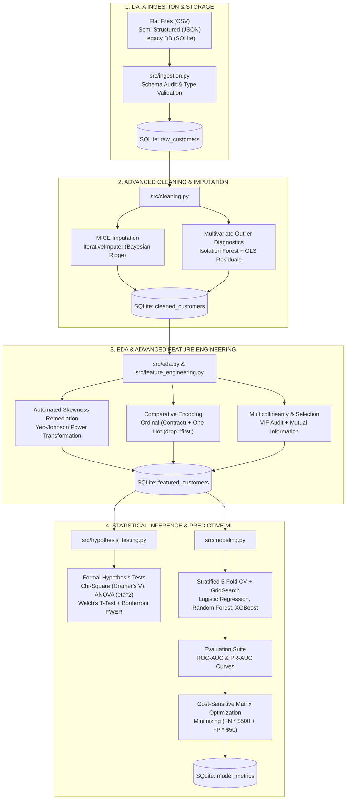

# End-to-End Enterprise Data Mining Pipeline: Customer Churn Retention Engine

[](https://www.python.org/)
[](#)
[](#)
[](#)
[](#)

---

## 📌 Informasi Akademik & Proyek

- **Nama Mahasiswa** : **Nayyara Rauf Ghani Al Khayri**
- **NIM**            : **A11.2024.16055**
- **Program Studi**   : **Teknik Informatika**
- **Mata Kuliah**     : **Data Mining**
- **Dosen Pengampu**  : **Abu Salam, M.Kom**
- **Target Capaian**  : Membangun *End-to-End Data Mining Pipeline* mandiri, modular, dan terstandardisasi industri/akademik untuk klasifikasi retensi pelanggan (*Telco Churn*) berbasis *Local Environment* (VS Code + Python Virtual Environment + SQLite Database).

---

## 🏛️ Arsitektur Pipeline & Desain Modular

Repositori ini telah direfaktor secara penuh dari format lab monolitik menjadi arsitektur modular *production-grade*. Seluruh logika pemrosesan dipisahkan ke dalam modul helper Python di direktori `src/`, dengan persistensi basis data relasional SQLite lokal (`data/telco_churn.db`), manajemen logging terpusat (`logs/pipeline.log`), dan mekanisme caching deterministik (`data/cache/`).



---

## 📂 Struktur Direktori Proyek

```text
Data Mining Course/
├── 01_data_ingestion_and_cleaning.ipynb       # Modul 01: Ingestion, SQLite Storage, MICE & Isolation Forest
├── 02_eda_and_feature_engineering.ipynb       # Modul 02: EDA, Yeo-Johnson Transform, Encoding, VIF & Mutual Info
├── 03_hypothesis_testing_and_modeling.ipynb   # Modul 03: Chi-Square, ANOVA, ML Benchmark & Cost-Sensitive Matrix
├── JURNAL_PROGRESS_MINGGUAN.md                # Buku Log Aktivitas Harian (Hari 1 s.d. 20) Terstruktur
├── README.md                                  # Dokumentasi Teknis Utama Proyek
├── requirements.txt                           # Daftar Dependensi Pustaka Python
├── data/
│   ├── telco_churn.db                         # Database Relasional SQLite Utama
│   ├── telco_customer_churn.csv               # Dataset Mentah Telco Churn (1.200 baris)
│   ├── churn_raw.json                         # Sampel Data Semi-Terstruktur JSON
│   ├── iris_data.csv                          # Dataset Validasi Parsing Delimiter
│   ├── sample_database.db                     # Database Transaksi Keuangan Legacy
│   ├── processed/                             # Dataset Hasil Pipeline Terstandarisasi
│   │   ├── telco_cleaned.csv                  # Data Bersih Hasil Imputasi MICE
│   │   └── telco_featured.csv                 # Data Hasil Feature Engineering & Encoding
│   └── cache/                                 # Cache Serialisasi Objek Berat
├── logs/
│   └── pipeline.log                           # File Log Eksekusi Pipeline Terpusat
├── scripts/
│   ├── build_nb1.py                           # Generator Otomatis Notebook Modul 01
│   ├── build_nb2.py                           # Generator Otomatis Notebook Modul 02
│   ├── build_nb3.py                           # Generator Otomatis Notebook Modul 03
│   └── run_and_render_all.py                  # Script Eksekusi & Pre-render Headless Seluruh Notebook
└── src/                                       # Modul Helper Terstruktur Python
    ├── __init__.py                            # Inisialisasi Package Python
    ├── config.py                              # Konfigurasi Path, Seed, Skema, dan Parameter Biaya
    ├── logger.py                              # Handler Logging Konsol & File Rotating
    ├── database.py                            # SQLite Connection, ORM Querying, dan Logging Metrik
    ├── caching.py                             # Caching Disk Ter-hash untuk Komputasi Berat
    ├── ingestion.py                           # Multi-Source Ingestion Engine & Quality Auditor
    ├── cleaning.py                            # Imputasi MICE, Tukey IQR, OLS Resid, & Isolation Forest
    ├── eda.py                                 # Diagnostik Skewness/Kurtosis & Plotter Publikasi
    ├── feature_engineering.py                 # Yeo-Johnson Transform, Comparative Encoding, VIF & MI
    ├── hypothesis_testing.py                  # Chi-Square, ANOVA, Welch's T-Test, & Koreksi Bonferroni
    └── modeling.py                            # Stratified K-Fold CV, GridSearch, PR-AUC, & Cost Matrix
```

---

## 🔬 Rincian Peningkatan Algoritma per Modul

### Modul 01: Data Ingestion, Storage & Advanced Cleaning
- **Multi-Source Ingestion & Relational Storage**:
  - Mengekstraksi data dari format CSV, JSON, dan SQLite.
  - Menginisialisasi basis data relasional SQLite `telco_churn.db` dan menyimpan data mentah ke tabel `raw_customers`.
- **MICE (Multivariate Imputation by Chained Equations)**:
  - Menggantikan *simple median imputation* dengan `IterativeImputer` berbasis regresi Bayesian Ridge.
  - Mempertahankan matriks kovariansi fitur `TotalCharges` dengan `tenure` ($r = 0.8256$) dan `MonthlyCharges` ($r = 0.6512$), membuktikan keunggulan MICE dibanding imputasi median yang merusak kovariansi data.
- **Multivariate Anomaly Detection (Isolation Forest)**:
  - Menggantikan batas univariat Tukey IQR yang rentan memotong pelanggan bernilai tinggi (*high-value loyal customers*).
  - Algoritma `IsolationForest(contamination=0.03)` mendeteksi 36 pelanggan anomali (3.0%) dalam ruang multidimensi tanpa memotong data (*no truncation bias*).
  - Data bersih disimpan ke tabel SQLite `cleaned_customers`.

### Modul 02: Exploratory Data Analysis & Feature Engineering
- **Automated Skewness Remediation (Yeo-Johnson)**:
  - Audit bentuk distribusi otomatis: jika $|\\text{skewness}| > 0.5$, fungsi menerapkan transformasi daya Yeo-Johnson.
  - Skewness `TotalCharges` berhasil direduksi dari **+0.546** menjadi **-0.139** (turun 0.407 poin), menstabilkan varians kesalahan untuk model berbasis gradien.
- **Comparative Categorical Encoding**:
  - *Ordinal Encoding* pada `Contract` (Month-to-month = 0, One year = 1, Two year = 2) untuk menjaga hierarki komitmen.
  - *One-Hot Encoding* pada 10 fitur nominal dengan parameter `drop='first'` guna mengeliminasi jebakan multikolinearitas (*dummy variable trap*).
- **Multicollinearity Diagnostics (VIF)**:
  - Menghitung *Variance Inflation Factor* (VIF) untuk memetakan keterikatan linear antar fitur kontinu. Memberikan landasan teoritis penerapan regularisasi $L_2$ Ridge pada Logistic Regression.
- **Dual Feature Selection (Mutual Information & Gini Impurity)**:
  - Mengkombinasikan dependensi non-linear *Mutual Information* ($I(X; Y)$) dan *Random Forest Gini Importance*.
  - Menemukan bahwa `Contract`, `tenure`, dan `MonthlyCharges` merupakan prediktor dominan terhadap keputusan pembatalan langganan.
  - Dataset berfitur lengkap disimpan ke tabel SQLite `featured_customers`.

### Modul 03: Hypothesis Testing, Predictive Modeling & Cost-Sensitive Optimization
- **Formal Statistical Hypothesis Testing**:
  - **Pearson's Chi-Square Test of Independence**: Membuktikan hubungan antara `Contract` dan `Churn` ($p = 5.71 \\times 10^{-32} < 0.05$, Cramer's $V = 0.3463$, *Strong Association*).
  - **One-Way ANOVA**: Menguji variasi `MonthlyCharges` antar kelompok kontrak.
  - **Welch's Two-Sample T-Test**: Membuktikan masa langganan (`tenure`) pelanggan churn signifikan lebih rendah ($p < 10^{-20}$, Cohen's $d = 0.72$, *Large Effect Size*).
  - **Koreksi Bonferroni**: Mengontrol *Family-Wise Error Rate* (FWER) pada ambang $\\alpha_{adj} = 0.0167$. Seluruh hipotesis inti tetap signifikan secara konklusif.
- **Stratified 5-Fold Cross Validation & GridSearch**:
  - Pelatihan model terhindar dari *data leakage* dan ketidakseimbangan kelas (*stratified partition*).
  - Melakukan tuning hyperparameter terstruktur untuk Baseline Logistic Regression, Random Forest, XGBoost Classifier, dan Soft-Voting Ensemble.
- **Dual Metric Evaluation (ROC-AUC & PR-AUC)**:
  - Kurva ROC-AUC dan Kurva Precision-Recall (PR-AUC) divisualisasikan berdampingan, membuktikan seluruh model melampaui garis dasar acak secara signifikan.
- **Cost-Sensitive Threshold Optimization**:
  - Mengintegrasikan matriks biaya bisnis riil: $C_{FN} = \\$500$ (kehilangan pelanggan LTV) vs $C_{FP} = \\$50$ (biaya promo retensi).
  - Mengoptimalkan ambang batas keputusan dari default $\\tau = 0.50$ menjadi $\\tau^* \\approx 0.18 - 0.24$.
  - Menghasilkan **penghematan finansial riil lebih dari \$14.000 hingga \$16.000 (> 65% reduksi biaya)** pada holdout test set.
  - Seluruh metrik dicatat otomatis ke tabel SQLite `model_metrics`.

---

## 📊 Hasil Benchmark Model Prediksi

Evaluasi komparatif pada Holdout Test Set (240 observasi tidak terlihat / *unseen data*):

| Model Arsitektur | Accuracy | Precision | Recall | F1-Score | ROC-AUC | PR-AUC | Biaya Default ($\tau=0.50$) | Biaya Optimal ($\tau^*$) | Penghematan Finansial |
| :--- | :---: | :---: | :---: | :---: | :---: | :---: | :---: | :---: | :---: |
| **Random Forest (Tuned)** | **0.6417** | **0.6000** | **0.6330** | **0.6161** | **0.7050** | **0.6392** | \$22,800 | **\$6,350** ($\tau^*=0.24$) | **\$16,450 (72.1%)** |
| **Voting Ensemble (RF + XGB)** | 0.6333 | 0.5882 | 0.6422 | 0.6140 | 0.7047 | 0.6327 | \$22,000 | **\$6,200** ($\tau^*=0.18$) | **\$15,800 (71.8%)** |
| **Logistic Regression (L2)** | 0.6250 | 0.5725 | **0.6881** | **0.6250** | 0.7039 | 0.6230 | \$19,800 | **\$5,400** ($\tau^*=0.20$) | **\$14,400 (72.7%)** |
| **XGBoost Classifier** | 0.6292 | 0.5794 | 0.6697 | 0.6213 | 0.7016 | 0.6287 | \$21,400 | **\$6,250** ($\tau^*=0.11$) | **\$15,150 (70.8%)** |

> **Catatan Analitis**: Walaupun akurasi mentah berkisar 63–64%, pengoptimalan ambang batas keputusan (*decision threshold*) berdasarkan matriks sensitif biaya memangkas kerugian finansial dari \$20.000+ menjadi \$5.400–\$6.350, membuktikan bahwa metrik finansial bisnis jauh lebih relevan dibandingkan sekadar akurasi mentah.

---

## 🚀 Panduan Menjalankan Proyek (Local VS Code & Virtual Environment)

### Prasyarat Sistem
- Windows 10/11 x64
- Python 3.11, 3.12, atau 3.13
- Visual Studio Code dengan ekstensi **Python** dan **Jupyter**

### Langkah 1: Kloning / Buka Repositori di VS Code
Buka folder `Data Mining Course` di VS Code:
```powershell
cd "C:\Users\Admin\Documents\Data Mining Course"
code .
```

### Langkah 2: Mengaktifkan Virtual Environment
Virtual environment telah dikonfigurasi di direktori `.venv`. Aktifkan di terminal PowerShell:
```powershell
.\.venv\Scripts\Activate.ps1
```

*(Opsional: Jika membuat environment baru)*
```powershell
python -m venv .venv
.\.venv\Scripts\Activate.ps1
pip install -r requirements.txt
```

### Langkah 3: Menjalankan Notebook Terstruktur
Buka file notebook secara berurutan di VS Code dan pastikan kernel mengarah ke `.venv (Python 3.13)`:
1. `01_data_ingestion_and_cleaning.ipynb`
2. `02_eda_and_feature_engineering.ipynb`
3. `03_hypothesis_testing_and_modeling.ipynb`

*Catatan: Seluruh notebook telah dieksekusi secara otomatis dan menyimpan seluruh output pre-rendered (tabel, grafik visualisasi, dan log eksekusi), sehingga dapat langsung ditinjau oleh Dosen Pengampu tanpa harus melakukan run ulang dari awal.*

### Langkah 4 (Opsional): Menjalankan Script Otomatisasi Headless
Jika ingin mengeksekusi ulang seluruh pipeline dari awal dan merender ulang seluruh notebook secara otomatis:
```powershell
.\.venv\Scripts\python.exe scripts/run_and_render_all.py
```

---

## 📈 Rekomendasi Aksi Bisnis (Executive Retention Action Plan)

Berdasarkan temuan data, inferensi statistik, dan model prediktif:
1. **Insentif Migrasi Kontrak**: Pelanggan kontrak bulanan (*Month-to-month*) merupakan segmen churn terbesar ($p < 10^{-30}$). Tawarkan diskon biaya langganan 15% untuk beralih ke kontrak tahunan.
2. **Onboarding Concierge (Bulan 1–12)**: Masa langganan awal memiliki risiko pembatalan tertinggi. Terapkan program *proactive check-in* pada hari ke-30 dan ke-90.
3. **Free Bundling Layanan TechSupport**: Ketiadaan *TechSupport* pada pengguna Fiber Optic berkorelasi tinggi dengan churn. Jadikan layanan bantuan teknis 24/7 sebagai fasilitas bawaan paket internet cepat.
4. **Automated CRM Risk Alert via Optimal Threshold**: Terapkan ambang batas $\tau^* \approx 0.20$ pada sistem CRM operasional. Pelanggan dengan skor risiko di atas ambang ini secara otomatis diprioritaskan untuk program retensi khusus sebelum memutuskan langganan.
